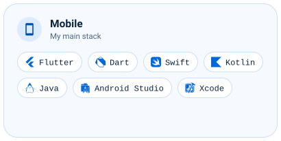
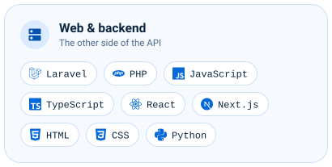
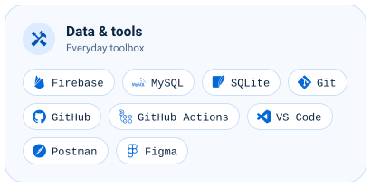
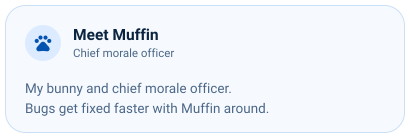
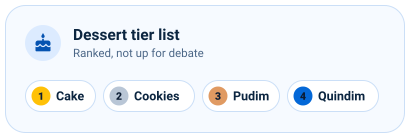
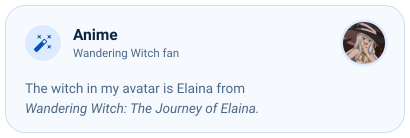
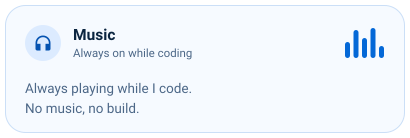

<div align="center">

<picture><source media="(prefers-color-scheme: dark)" srcset="./assets/dark/hero.svg" /></picture>

<p>
  <a href="https://linkedin.com/in/abdul-azis-alayubbi"><picture><source media="(prefers-color-scheme: dark)" srcset="./assets/dark/btn-linkedin.svg" /></picture></a>
  <a href="https://app.daily.dev/abdulazisalayubbi"><picture><source media="(prefers-color-scheme: dark)" srcset="./assets/dark/btn-dailydev.svg" /></picture></a>
</p>


</div>

## About me

```dart
class AbdulAzis extends StatelessWidget {
  const AbdulAzis({super.key});

  @override
  Widget build(BuildContext context) {
    return const Developer(
      role: 'Mobile App Engineer',
      location: 'Jakarta, Indonesia 🇮🇩',
      education: 'Telkom University',
      mainStack: ['Flutter', 'Dart', 'Swift', 'SwiftUI'],
      alsoUses: ['Laravel', 'PHP', 'JavaScript', 'Next.js'],
      currentlyLearning: ['DevOps', 'CI/CD', 'Clean Architecture'],
      motto: 'Ship it, learn from it, make it better.',
    );
  }
}
```

## Tech stack

<p align="center">
  <picture><source media="(prefers-color-scheme: dark)" srcset="./assets/dark/stack-mobile.svg" /></picture><picture><source media="(prefers-color-scheme: dark)" srcset="./assets/dark/stack-web.svg" /></picture><picture><source media="(prefers-color-scheme: dark)" srcset="./assets/dark/stack-tools.svg" /></picture><picture><source media="(prefers-color-scheme: dark)" srcset="./assets/dark/stack-doctor.svg" /></picture>
</p>

## Fun corner

<p align="center">
  <picture><source media="(prefers-color-scheme: dark)" srcset="./assets/dark/fun-muffin.svg" /></picture><picture><source media="(prefers-color-scheme: dark)" srcset="./assets/dark/fun-dessert.svg" /></picture><picture><source media="(prefers-color-scheme: dark)" srcset="./assets/dark/fun-anime.svg" /></picture><picture><source media="(prefers-color-scheme: dark)" srcset="./assets/dark/fun-music.svg" /></picture>
</p>

<p align="center">
  
  <br /><br />
  <picture><source media="(prefers-color-scheme: dark)" srcset="https://readme-jokes.vercel.app/api?hideBorder=true&bgColor=%230B1C33&textColor=%23EAF4FF&qColor=%23EAF4FF&aColor=%234DB8FF&borderColor=%231D3A63" /></picture>
</p>

## GitHub activity

<p align="center">
  <picture><source media="(prefers-color-scheme: dark)" srcset="https://streak-stats.demolab.com?user=abdulazisalayubbi&hide_border=true&border_radius=16&background=0B1C33&ring=13B9FD&fire=FFC107&currStreakLabel=4DB8FF&sideLabels=EAF4FF&dates=9DB7D5&currStreakNum=EAF4FF&sideNums=EAF4FF&stroke=1D3A63" /></picture>
  <br />
  <picture><source media="(prefers-color-scheme: dark)" srcset="https://github-readme-activity-graph.vercel.app/graph?username=abdulazisalayubbi&bg_color=0B1C33&color=EAF4FF&line=13B9FD&point=4DB8FF&area=true&area_color=027DFD&hide_border=true&radius=16" /></picture>
</p>

<div align="center">

**Thanks for stopping by! Feel free to reach out if you'd like to build something together.** 🤝

<picture><source media="(prefers-color-scheme: dark)" srcset="./assets/dark/footer.svg" /></picture>

</div>
